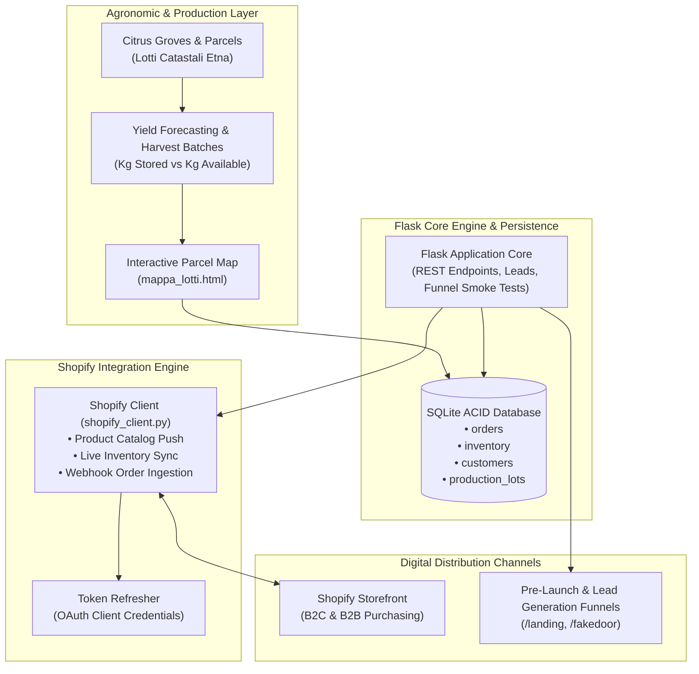

# 🍊 RossoVivo Platform — Agritech E-Commerce & Supply Chain Inventory Engine

[](https://www.python.org/)
[](https://flask.palletsprojects.com/)
[](https://shopify.dev/)
[](https://www.sqlite.org/)
[](https://opensource.org/licenses/MIT)

> **Enterprise Agritech platform connecting agronomic harvest scheduling, batch lot traceability, and bidirectional Shopify Admin API inventory synchronization for premium agricultural commodities.**

---

## 🇮🇹 Executive Summary (Italiano)

**RossoVivo Platform** è una soluzione integrata agritech ed e-commerce concepita per gestire la filiera corta di agrumi siciliani d'eccellenza (Arance Rosse IGP Tarocco e Moro).  
Il sistema fa da ponte tra la produzione agronomica in campo (mappatura lotti, stima resa in kg per ettaro, data ottimale di raccolta per grado zuccherino e pigmentazione) e la vendita diretta sia al consumatore finale (B2C) che a distributori esteri (B2B), sincronizzando in tempo reale il catalogo prodotti e le giacenze tramite le **API Admin di Shopify**.

### Punti di Forza Ingegneristici:
- **Sincronizzazione Bidirezionale Shopify:** Connessione Machine-to-Machine (M2M) con rinnovo automatico del token di accesso (Client Credentials Grant), gestione dei rate limits e riconciliazione ordini.
- **Tracciabilità di Lotto (Farm-to-Fork):** Monitoraggio della provenienza agronomica di ciascuna cassa venduta, collegando il codice lotto (`batch_lot`) al lotto catastale e alla finestra di raccolta.
- **Controllo di Gestione del Margine Unitario:** Calcolo in tempo reale di COGS (Cost of Goods Sold), spese di spedizione refrigerata, costi di imballaggio e margine operativo netto per chilogrammo.

---

## 🏛️ System Architecture



---

## ⚡ Technical Highlights

1. **Autonomous Shopify M2M Authentication:**
   - Implements automated token refresh logic using Shopify's modern Client Credentials Grant, abstracting authentication headers for background daemons.
2. **Idempotent Inventory Sync:**
   - Database operations use `ON CONFLICT(sku) DO UPDATE` to guarantee that concurrent stock changes from field harvesting and online sales never produce race conditions.
3. **Smoke Testing & Validation Architecture:**
   - Includes validation routes (`/fakedoor`, `/landing`) to conduct market demand validation and measure CAC/conversion rates before crop harvesting.

---

## 🚀 Quickstart

### 1. Requirements
- Python >= 3.10
- Dependencies in `requirements.txt`

### 2. Installation
```bash
git clone https://github.com/GabriMannino-pt/RossoVivo-Platform.git
cd RossoVivo-Platform
pip install -r requirements.txt
```

### 3. Initialize Database
Initialize the SQLite schema with table indexes:
```bash
python init_db.py
```

### 4. Configure Environment
Copy `.env.example` to `.env` and fill in your Shopify credentials:
```bash
cp .env.example .env
```

### 5. Launch Application
```bash
python app.py
```
Visit `http://localhost:5000` to access the platform.

---

## 📁 Repository Structure

```
RossoVivo-Platform/
├── templates/
│   ├── index.html               # Main dashboard UI
│   ├── landing_agosto.html      # Lead acquisition funnel
│   └── landing_fakedoor.html    # Market validation test
├── sample_data/
│   └── mock_catalog.json        # Synthetic product catalog & batches
├── mappa_lotti.html             # Field parcel mapping viewer
├── shopify_client.py            # Shopify Admin API wrapper & token manager
├── app.py                       # Flask server & business endpoints
├── init_db.py                   # Database schema definition
├── create_initial_catalog.py    # Product seeding script
├── .env.example                 # Configuration template
├── .gitignore                   # Strict compliance filter
├── requirements.txt             # Python dependencies
└── README.md                    # Enterprise technical specification
```

---

## 🛡️ Privacy & Compliance Notice
This repository contains the software engine and synthetic mock catalog data. **No real customer records, private tax documents, purchase invoices, or live store production secrets are stored or committed.**

---

## 👨‍💻 Author
**Gabriele Mannino**  
- Software Engineer & Automation Architect  
- LinkedIn: [linkedin.com/in/gabriele-mannino-dev](https://linkedin.com/in/gabriele-mannino-dev)  
- GitHub: [@GabriMannino-pt](https://github.com/GabriMannino-pt)  
- Email: `gabri.mannino.lavoro@gmail.com`
